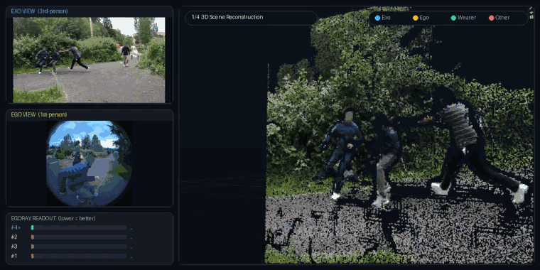
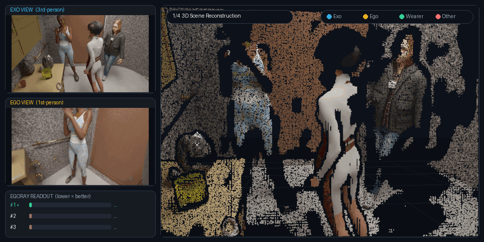
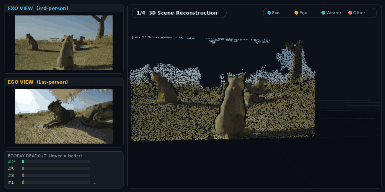
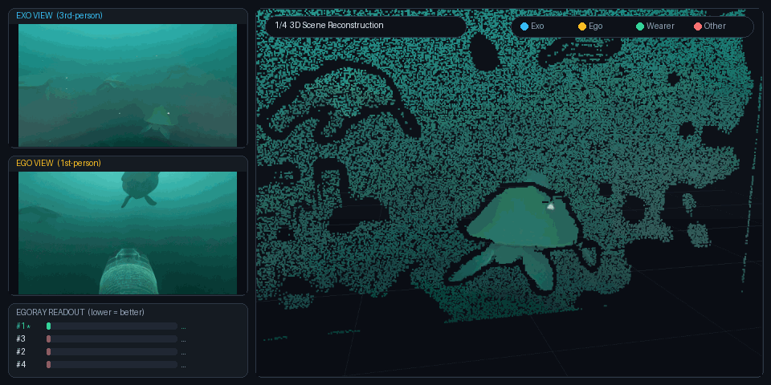

<div align="center">
<h1>Who Is Ego? Scaling Cross-View Camera Wearer Identification and Segmentation beyond Humans</h1>

<p>
  <strong>Yifan Jin</strong><sup>1*</sup>,
  <strong>Zheng Zhang</strong><sup>2*</sup>,
  <strong>Tianwen Qian</strong><sup>3</sup>,
  <strong>Dong Wang</strong><sup>4</sup>,
  <strong>Bo Zhao</strong><sup>5</sup>,
  <strong>Yanwei Fu</strong><sup>2,6</sup>,
  <strong>Yuqian Fu</strong><sup>7&dagger;</sup>
</p>
<p>
  <sup>1</sup>Central South University &nbsp;&middot;&nbsp;
  <sup>2</sup>Fudan University &nbsp;&middot;&nbsp;
  <sup>3</sup>East China Normal University &nbsp;&middot;&nbsp;
  <sup>4</sup>Shanghai AI Laboratory &nbsp;&middot;&nbsp;
  <sup>5</sup>Shanghai Jiao Tong University &nbsp;&middot;&nbsp;
  <sup>6</sup>Shanghai Innovation Institute &nbsp;&middot;&nbsp;
  <sup>7</sup>KAUST
</p>
<p><sub><sup>*</sup>Equal contribution. &nbsp; <sup>&dagger;</sup>Corresponding author.</sub></p>

<p>
  <a href="https://arxiv.org/abs/2611.34489"></a>
  <a href="https://travor278.github.io/EgoRay/"></a>
  <a href="https://huggingface.co/spaces/Travor278/FindEgo-1M"></a>
  <a href="https://huggingface.co/datasets/Travor278/FindEgo-1M"></a>
  <a href="https://huggingface.co/Travor278/EgoRay"></a>
  <a href="LICENSE"></a>
</p>

<a href="#demo">Demo</a> |
<a href="#overview">Overview</a> |
<a href="#findego-1m">FindEgo-1M</a> |
<a href="#installation">Installation</a> |
<a href="#usage">Usage</a> |
<a href="#citation">Citation</a>
</div>

## Demo

EgoRay lifts an exo–ego image pair into a shared 3D point cloud, estimates both camera poses, and casts the epipole ray from the exo camera through the predicted ego camera to rank candidate masks in 3D.

<p align="center">
  
  <br>
  <sub>Real humans (EgoHumans, 12-view dense 3D): 0.07° epipole angular offset; wearer in green, other candidates marked with red dots.</sub>
</p>
<p align="center">
  
  <br>
  <sub>Indoor multi-person scene (FindEgo-1M, 7-view dense 3D): 0.16° angular offset across 3 candidates.</sub>
</p>
<p align="center">
  
  <br>
  <sub>Beyond humans (FindEgo-1M wild animals, 12-view dense 3D): 3D depth resolves foreground occluder (#5) from the camera-carrying lion (#2) at 0.06° angular offset.</sub>
</p>
<p align="center">
  
  <br>
  <sub>Beyond humans (FindEgo-1M underwater): camera-carrying sea turtle (#1) identified among 5 candidates at 0.07° angular offset.</sub>
</p>

Run the interactive 3D viewer (`gr.Model3D` point cloud, camera frustums, and EgoRay epipole ray, modeled on VGGT-Ω's Gradio demo) or export `.glb` scenes and animations from the command line:

```bash
pip install -r requirements_demo.txt
python tools/demo_gradio.py --ckpt weights/vggt_omega_1b_512.pt --adapter weights/egoray/lora.pt
```

## Overview

A first-person (ego) image shows what a camera sees, but not who or what carries it. Given a synchronized third-person (exo) image, **camera wearer identification** asks which candidate carries the ego camera. We extend the task beyond humans to robots, vehicles, animals, and drones, and to three tracks:

| Track | Input | Output |
|---|---|---|
| A. Wearer identification | ego image, exo image, candidate masks | the wearer's mask |
| B. Wearer segmentation | ego image, exo image, the set's category words | the wearer's mask, or *absent* |
| C. Mutual camera localization | ego image, exo image | each camera's direction in the other image |

**EgoRay** identifies the wearer from predicted camera geometry. VGGT-Ω predicts the relative pose of the two cameras and the exo depth; the ego camera projects into the exo image (the epipole), and the wearer is the candidate closest to it in angle and distance. **EgoRay-ZS** uses VGGT-Ω as released. **EgoRay** adds LoRA adapters trained with pose supervision on FindEgo-1M and adapts them on the unlabeled queries of each test set.

## FindEgo-1M

1.16M real and simulated ego–exo pairs, 12 wearer types, 17 domains, and 111 test settings at four levels of generalization (L0–L3). The data are on Hugging Face at [Travor278/FindEgo-1M](https://huggingface.co/datasets/Travor278/FindEgo-1M) (gated, non-commercial research use). To get the queries and lists:

```bash
hf download Travor278/FindEgo-1M --repo-type dataset --include "queries/*" "lists/*" --local-dir data
```

Simulated images are packed per scene under `simulated/<domain>/<set>/`; the dataset card lists the layout. Images of the real source datasets are not redistributed; get them from the datasets listed in the paper.

Each set is a gzip JSON-lines file of queries, `queries/<set>.jsonl.gz`, with key lists `lists/<set>.{train,dev,test,gold}.txt`:

| Field | Meaning |
|---|---|
| `key`, `set`, `scene` | query id, set name, scene id |
| `exo`, `ego` | image paths relative to the data root |
| `exo_kind` | `fixed` or `peer` |
| `mask`, `cands` | instance-id PNG of the exo image and the candidate ids |
| `boxes` / `polys`, `hw` | candidates of sets without masks |
| `state`, `wearer` | `present`, `absent` or `ignore`, and the wearer's id |
| `category` | category words of the set's wearers (Track B) |
| `level`, `gt_tier` | level of generalization of a test query, label tier |
| `w2c_exo`, `w2c_ego`, `K_exo`, `K_ego`, `pose_tier` | ground-truth cameras, for pose-supervised training and scoring (never an input at inference) |
| `lens_exo`, `lens_ego` | lens model of each image; without one a camera counts as pinhole, which enables focal supervision on P0 poses |
| `eg_gt` | optional ego-side direction when full camera poses are missing |
| `modality` | optional; separates settings of one set (e.g. thermal) |

## Installation

```bash
conda create -n egoray python=3.11 -y
conda activate egoray
pip install torch==2.8.0 torchvision==0.23.0 --index-url https://download.pytorch.org/whl/cu128
pip install -r requirements.txt

git clone https://github.com/facebookresearch/vggt-omega third_party/vggt-omega
git -C third_party/vggt-omega checkout 48b23c8
export PYTHONPATH=$PWD/third_party/vggt-omega:$PYTHONPATH
```

Weights:

| Model | Source | File |
|---|---|---|
| VGGT-Ω | `facebook/VGGT-Omega` | `weights/vggt_omega_1b_512.pt` |
| SAM 3 (Track B) | `facebook/sam3`, `pip install sam3` | `weights/sam3.pt` |
| EgoRay adapters | [`Travor278/EgoRay`](https://huggingface.co/Travor278/EgoRay) | `weights/egoray/lora.pt` |

```bash
hf download Travor278/EgoRay ego_f_s0_lora.pt --local-dir weights/egoray
mv weights/egoray/ego_f_s0_lora.pt weights/egoray/lora.pt
```

## Usage

**One pair.** Candidates come from an instance-id mask of the exo image (or a JSON list of boxes). Pass `--glb` to export an interactive 3D point cloud with camera frustums and the EgoRay epipole ray, or `--anim` to render a 3D walkthrough animation (`.gif` or `.mp4`):

```bash
python tools/demo.py --exo exo.jpg --ego ego.jpg --mask exo_instances.png \
    --ckpt weights/vggt_omega_1b_512.pt --out demo.png --glb scene.glb --anim demo_3d.gif
```

Add `--adapter weights/egoray/lora.pt` for EgoRay, and `--boxes boxes.json` instead of `--mask` for boxes. For an interactive browser demo with `gr.Model3D`, run `tools/demo_gradio.py`.

**Evaluation.** Predict both input orders once, then score Tracks A and C:

```bash
python tools/predict.py --queries data/queries/people_v1.jsonl.gz --data-root data --keys data/lists/people_v1.gold.txt \
    --ckpt weights/vggt_omega_1b_512.pt --out preds/egoray_zs
python tools/evaluate.py --queries data/queries --lists data/lists --split gold --sets people_v1 --pred preds/egoray_zs \
    --data-root data --out scores/egoray_zs.json
```

`evaluate.py` stops if a listed query has no prediction; `--allow-missing` scores the others.

Track B ranks SAM 3 proposals. This zero-shot example uses the paper's presence threshold of 12°:

```bash
python tools/propose.py --queries data/queries/people_v1.jsonl.gz --data-root data --ckpt weights/sam3.pt --out proposals
python tools/evaluate.py --queries data/queries --lists data/lists --split gold --sets people_v1 --pred preds/egoray_zs \
    --data-root data --proposals proposals --theta 12 --out scores/egoray_zs_b.json
```

Without `--theta`, `evaluate.py` chooses one threshold on the development lists (by default every `*.dev.txt` list under `--lists`). Run `predict.py` without `--keys` with the starting model on the evaluated sets and on every set with a development list, writing all predictions into one new directory. Run `propose.py` on the same sets and pass the prediction directory as `--pred`. With `--pred-b`, give the starting model's threshold as `--theta`.

**Pose-supervised training.**

```bash
torchrun --standalone --nproc_per_node=2 tools/train.py --queries data/queries --lists data/lists --data-root data \
    --ckpt weights/vggt_omega_1b_512.pt --out runs/egoray --samples 520000 --bs 4 --rank 64
```

**Test-time adaptation**, one adapter per test set on its unlabeled Gold queries (200 steps from a trained adapter, 800 from VGGT-Ω):

```bash
python tools/adapt.py --queries data/queries --lists data/lists --data-root data --set birds_v1 \
    --ckpt weights/vggt_omega_1b_512.pt --adapter runs/egoray/lora.pt --out runs/tta/birds_v1
python tools/predict.py --queries data/queries/birds_v1.jsonl.gz --data-root data --keys data/lists/birds_v1.gold.txt \
    --ckpt weights/vggt_omega_1b_512.pt --adapter runs/tta/birds_v1/lora.pt --out preds/egoray
```

For Track B, adapt a separate copy on the SAM 3 proposals with `--proposals proposals` and another `--out` (e.g. `runs/tta_b/birds_v1`). Predict with that adapter into its own directory and pass it to `evaluate.py` as `--pred-b`, together with the starting model's `--theta`.

## Acknowledgement

This code builds on [VGGT-Ω](https://github.com/facebookresearch/vggt-omega) and SAM 3. FindEgo-1M adds labels to recordings of public datasets listed in the paper.

## License

The code is released under the [MIT License](LICENSE). The data, the model weights, and the source datasets keep their own terms.

## Citation

```bibtex
@article{jin2026whoego,
  title   = {Who Is Ego? Scaling Cross-View Camera Wearer Identification and Segmentation beyond Humans},
  author  = {Jin, Yifan and Zhang, Zheng and Qian, Tianwen and Wang, Dong and Zhao, Bo and Fu, Yanwei and Fu, Yuqian},
  journal = {arXiv preprint arXiv:2611.34489},
  year    = {2026}
}
```
